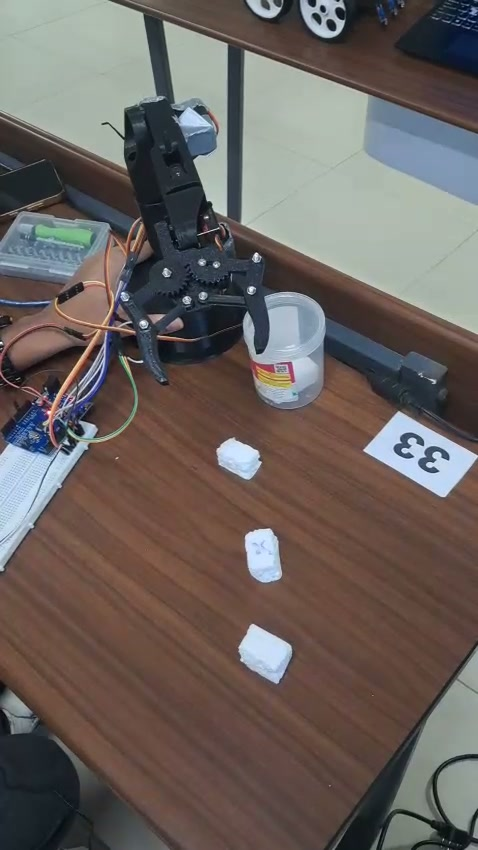

# Tic-Tac-Toe Playing Robotic Arm

A six-servo, 3D-printed robotic arm built with Arduino Uno for our Tic-Tac-Toe project. The image shows the prototype after a pick-and-place demonstration with three thermocol pieces.

